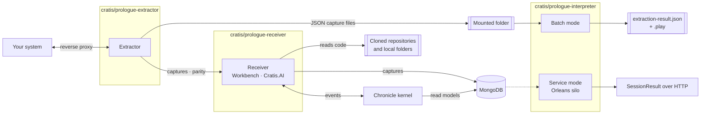
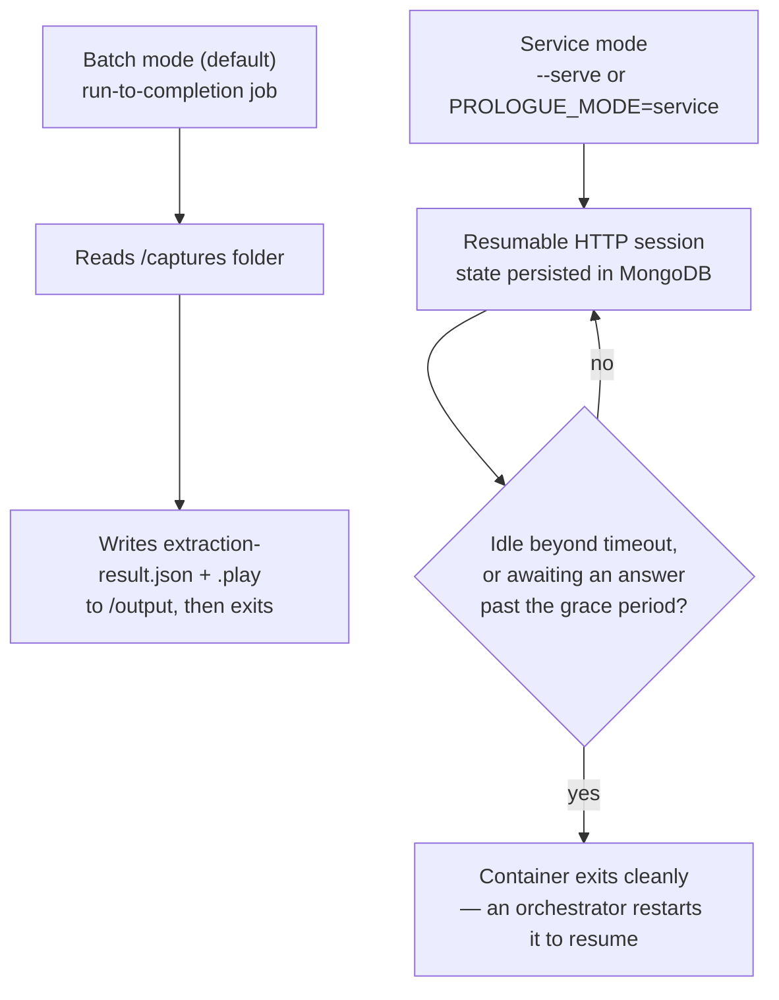

Prologue is deliberately self-contained and has no dependency on Studio. The Extractor is an ordinary sidecar
service. The Receiver collects captures and hosts the Workbench, which needs a Chronicle kernel and MongoDB. The
Interpreter supports two hosting shapes: a run-to-completion batch process and a resumable HTTP service. Only the
resumable service mode embeds an Orleans silo; file-based capture and batch interpretation need neither Orleans
nor the Workbench.

## The pieces

- **Extractor** — a reverse proxy plus a database and telemetry watcher, all in one process. It's the only piece that has to run continuously, next to the system it's watching. One Extractor captures a whole system, including one made of several [named services](reference/configuration.md#prologueservices): it attributes every observation to its service and correlates each service on its own.
- **Receiver** — receives what the Extractor posts (`POST /captures`, `POST /prologues/{id}/captures`, and `POST /prologues/{id}/parity` when shadowing) and stores each capture in MongoDB via `Cratis.Prologue.Storage`, keeping its service. It also hosts the **Workbench**, a web interface that is an event-sourced Cratis application: it records its decisions as events in a Chronicle event store named `Prologue`, reads projections of them from MongoDB, and uses Cratis.AI for the language-model work. The Receiver and Chronicle have to share one MongoDB server. The Receiver is optional — the Extractor can write JSON files to a mounted folder instead, with no Receiver, Chronicle or MongoDB involved at all.
- **Interpreter** — a job, not a service, by default. It reads a folder of capture files, interprets them, and exits. A second mode embeds Orleans and keeps interpretation running as resumable session grains with state backed by MongoDB.

The shared `Cratis.Prologue.Contracts`, `Cratis.Prologue.Configuration`, and
`Cratis.Prologue.Interpreter.Contracts` packages define the canonical capture, configuration, and extraction-result
formats. `Cratis.Prologue.Interpretation` contains the interpretation engine, and `Cratis.Prologue.Screenplay`
converts an extraction result into a `.play` document.

## The Workbench

The Workbench walks a system from a definition of where its code lives and what to capture, through discovery,
capture, exploration and event review, to a provisional model and a piece-by-piece rebuild. It runs inside the
Receiver, so starting the Receiver starts it: see [Running the Workbench](guides/running-the-workbench.md) and the
[walkthrough](guides/workbench-walkthrough.md).

Captures keep going to MongoDB as before, because the Interpreter reads them there. The Receiver also records a
summary of each capture, without row values, as an event in Chronicle. Everything the Workbench shows beyond the raw
captures is a projection of those and of the decisions you make. The Receiver clones the repositories it analyzes
(read-only, shallow, sparse) or reads local folders, and sends model requests through the providers you configure in
Cratis.AI. See [Receiver configuration](reference/receiver-configuration.md), [Repository connections](reference/repository-connections.md)
and [AI setup](reference/ai-setup.md).

## Two ways to run the Interpreter

**Batch mode** is what you get from the image by default, and what the [Cratis CLI](/cli/reference/prologue/)'s `cratis prologue interpret` drives — a folder of captures in, an `ExtractionResult` and a Screenplay `.play` file out, then the container exits. See [Running the Interpreter](guides/running-the-interpreter.md).

**Service mode** embeds an Orleans silo and hosts interpretation as resumable session grains over HTTP. Session
state persists in MongoDB, so a session waiting for answers can resume after the process restarts. This mode is
intended for interactive integrations; use batch mode when you only need file-based input and output.

## No dependency on Studio

Nothing here requires Studio to be running. If you only want an `ExtractionResult` and `.play` file, the Extractor
and batch Interpreter are the complete Prologue pipeline; the [Cratis CLI](/cli/reference/prologue/) provides the
corresponding command workflow.

## Next

- **[Point Prologue at your system](guides/point-prologue-at-your-system.md)** — wiring the Extractor up to something real.
- **[Running the Workbench](guides/running-the-workbench.md)** — start the Receiver with Chronicle and MongoDB.
- **[Reference — Configuration](reference/configuration.md)** — every `cratis-prologue.json` property.
