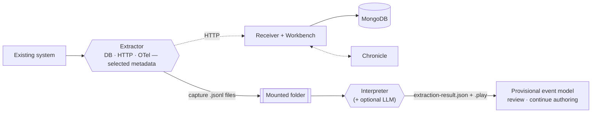

Prologue captures selected HTTP commands, database changes, and telemetry from an existing system and proposes
an event model. You review and correct its candidate commands, events, read models, and projections rather than
treating observed behavior as recovered domain intent.

## Get started

- **[Run the bundled sample](getting-started.md)** — watch Prologue capture a sample system, then turn captures
  into a provisional `.play` file for review.
- **[Point Prologue at your system](guides/point-prologue-at-your-system.md)** — configure capture for a system
  you have permission to observe.

You can adopt Prologue independently without adopting the whole Cratis Platform. Its observations give you
evidence to compare with the team's understanding of the system and use when deciding what to preserve or
change. They do not, on their own, establish that the system needs a rewrite.

Prologue does not capture database row values or HTTP bodies. Its metadata can still be sensitive: HTTP
observations include query strings, telemetry includes identifiers and names, and explicitly allowlisted
OpenTelemetry attributes include their values. Minimize the capture configuration and protect the resulting
files and persisted observations. Observe a real system only with its owner's permission. File-based batch
interpretation can run without LLM refinement; the Workbench's Discover and interpretation steps can use AI providers you configure. Before using
AI features, separately authorize any capture evidence or source code sent to the configured providers.

## How it fits together

The **Extractor** watches the system through database change capture, an HTTP reverse proxy, and an OpenTelemetry
proxy. It correlates observations into **captures** using trace identifiers where available and a time window
otherwise. It writes captures to a mounted folder or posts them to the **Receiver**, which stores them in MongoDB and hosts the **Workbench**, a web interface that records your decisions as events in Chronicle.
The **Interpreter** analyzes those captures heuristically, can optionally refine names and descriptions with a
language model, and produces an `ExtractionResult` plus a generated [Screenplay](/screenplay/) `.play` file.

Prologue has no dependency on Studio. The Extractor and batch Interpreter need neither Orleans nor Chronicle; the Receiver needs Chronicle only to host the Workbench. The
Interpreter's optional resumable service mode embeds an Orleans silo for persisted interpretation sessions.

## The cast

| Piece | What it is | Ships as |
|---|---|---|
| Extractor | Watches the system: SQL Server CDC, Postgres logical replication, an HTTP reverse proxy, and an OTLP proxy | `cratis/prologue-extractor` (Docker) |
| Interpreter | Reads captures and interprets them into an event model and a Screenplay | `cratis/prologue-interpreter` (Docker) |
| Receiver | Takes the captures the Extractor posts, stores them in MongoDB, and hosts the Workbench (with Chronicle and Cratis.AI) | `cratis/prologue-receiver` (Docker) |
| `Cratis.Prologue.Contracts` | The capture contract and canonical JSON/capture-file formats | NuGet |
| `Cratis.Prologue.Configuration` | Typed `cratis-prologue.json` configuration for the Extractor and Interpreter | NuGet |
| `Cratis.Prologue.Storage` | MongoDB persistence for captures, used by the Receiver and by Studio | NuGet |
| `Cratis.Prologue.Interpreter.Contracts` | The `ExtractionResult` contract | NuGet |
| `Cratis.Prologue.Interpretation` | Heuristic construction and optional language-model refinement | NuGet |
| `Cratis.Prologue.Screenplay` | Conversion from an extraction result to a `.play` document | NuGet |

See [Architecture](architecture.md) for how these pieces compose and deploy.

## Further reading

- **[Why Prologue](why-prologue.md)** — the problem it solves, and when it's the wrong tool for the job.
- **[How Prologue works](concepts.md)** — the capture, correlation, and interpretation pipeline in depth.
- **[Running the Workbench](guides/running-the-workbench.md)** — start the local web interface with Docker Compose, then follow the workflow from system definition to rebuild. Opening the Workbench is a separate step from capturing a system and reviewing its model.

Prefer driving it from a terminal? The [Cratis CLI](/cli/reference/prologue/) wraps the wizard and the Interpreter in two commands: `cratis prologue start` and `cratis prologue interpret`.
